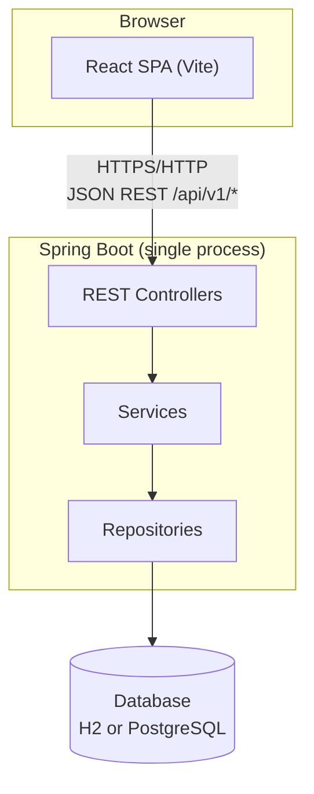
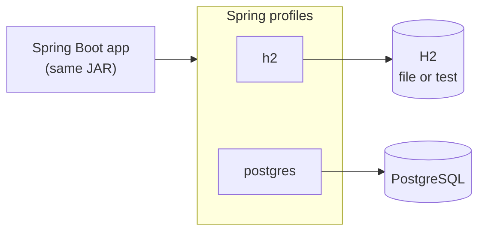
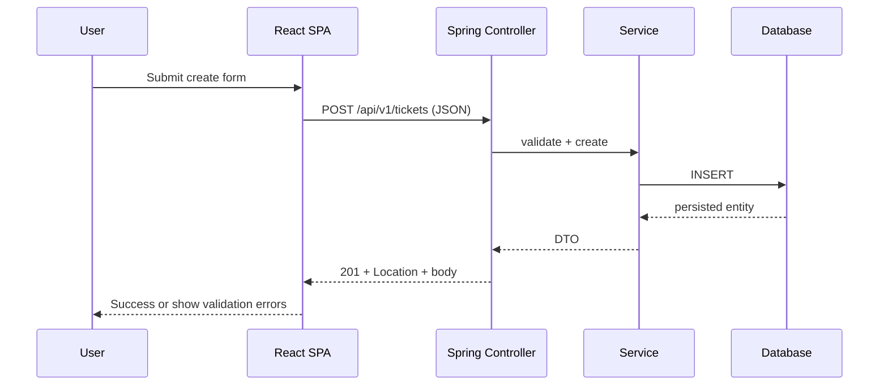

# Support Ticket Management System — Architecture

**Document status:** Approved (synced with implementation)  
**Version:** 0.2  
**Last updated:** 2026-10-26  
**Related:** [requirements.md](./requirements.md)

## 1. Overview

The system is a **small monolithic application** delivered as two cooperating parts in one repository: a **Spring Boot REST API** (`backend/`) and a **React SPA** (`frontend/`). There is a single database per running backend instance, accessed synchronously over JDBC. No microservices, message brokers, or application-level caching layer are planned.



**Runtime (local development):** The user runs the Vite dev server for the UI and the Spring Boot app for the API on separate ports. The browser loads the SPA from Vite and calls the API on the backend port (cross-origin in dev; see §6).

**Runtime (production-like):** The same logical shape applies: one API process and one way to serve the built static frontend (exact hosting choice is an implementation detail in `docs/`, not a separate service tier).

---

## 2. Repository layout

| Path | Role |
|------|------|
| `backend/` | Java 21, Spring Boot, Maven or Gradle; REST API and persistence |
| `frontend/` | React, TypeScript, Vite; ticket UI and API client |
| `spec/` | Requirements, architecture, API contract (source of truth for behaviour) |
| `docs/` | Setup, ADRs, operational notes |

---

## 3. Backend architecture (Spring Boot)

### 3.1 Layering

Dependencies flow in one direction only:

**Controller → Service → Repository → Database**

| Layer | Package (conventional) | Responsibility |
|-------|------------------------|----------------|
| **Controller** | `...web` or `...controller` | HTTP mapping, status codes, `@Valid` on request bodies; no business rules |
| **Service** | `...service` | Business logic, orchestration, entity↔DTO mapping, `@Transactional` boundaries |
| **Repository** | `...repository` | Spring Data JPA interfaces; queries and persistence only |
| **Domain** | `...domain` or `...model` | JPA entities; not exposed on the wire |
| **DTO** | `...dto` | Request/response records for the REST API |
| **Config** | `...config` | Profile-specific beans (e.g. CORS), Jackson, OpenAPI optional |
| **Exception handling** | `...exception` + `@RestControllerAdvice` | Maps exceptions to the standard error JSON (see project API rules) |

Cross-cutting concerns stay minimal: a global exception handler, validation via Bean Validation on DTOs, and structured logging (no secrets in logs).

### 3.2 API surface

- Base path: **`/api/v1`**
- JSON request and response bodies
- Resource-oriented URLs for tickets and nested comments (normative contract: [api-contract.md](./api-contract.md))

The frontend never talks to the database; all persistence goes through the REST API.

### 3.3 Persistence

- **Spring Data JPA** with a relational schema for tickets and comments
- Schema evolution via migrations (e.g. Flyway/Liquibase) or a deliberate ddl strategy documented at implementation time—chosen in the build plan, not split across services

---

## 4. Frontend architecture (React + Vite)

### 4.1 Structure (conventional)

| Area | Purpose |
|------|---------|
| `src/pages` | Route-level views (list, detail, create/edit) |
| `src/components` | Reusable UI pieces (forms, lists, error display) |
| `src/services` or `src/api` | HTTP client wrappers for `/api/v1` endpoints |
| `src/types` | TypeScript types aligned with API DTOs |

### 4.2 UI behaviour

- **Server is authoritative:** Forms submit to the API; validation errors from the API are shown to the user (field-level where provided).
- **API base URL** comes from configuration (§5), not hardcoded hosts in component code.
- Routing is client-side (e.g. React Router) for list → detail navigation.

### 4.3 Optional dev convenience

Vite **proxies** `/api` to the backend during local development when `VITE_API_BASE_URL` is empty (implemented). Production builds use explicit API URL configuration. Optional backend CORS is documented in §8 when the SPA calls the API origin directly.

---

## 5. Configuration and secrets

### 5.1 Principles

- **No secrets in source control.** `.env` and local overrides are gitignored; commit **`.env.example`** with placeholder names and non-sensitive defaults only.
- **Environment variables** supply secrets and environment-specific values at runtime (Spring `${VAR}` placeholders, Vite `VITE_*` for client-safe settings).
- **Profiles** select behaviour bundles (database, CORS), not a substitute for keeping passwords out of YAML committed to the repo.

### 5.2 Spring Boot

| Concern | Mechanism |
|---------|-----------|
| Active profile | `SPRING_PROFILES_ACTIVE` (`h2` default, or `postgres`) |
| HTTP port | `SERVER_PORT` or `application-*.yml` with env override |
| JDBC URL, user, password | `SPRING_DATASOURCE_URL`, `SPRING_DATASOURCE_USERNAME`, `SPRING_DATASOURCE_PASSWORD` (or project-specific names mapped in YAML) |
| Other toggles | Profile blocks in `backend/src/main/resources/application.yml` (`h2`, `postgres`); secrets only via env vars for PostgreSQL |

Example pattern in YAML (illustrative):

```yaml
spring:
  datasource:
    url: ${SPRING_DATASOURCE_URL:jdbc:h2:file:./data/tickets}
    username: ${SPRING_DATASOURCE_USERNAME:sa}
    password: ${SPRING_DATASOURCE_PASSWORD:}
```

### 5.3 React (Vite)

| Variable | Purpose |
|----------|---------|
| `VITE_API_BASE_URL` | Origin + optional path prefix for API calls (e.g. `http://localhost:8080`) |

Only variables prefixed with `VITE_` are exposed to browser code. **Do not** put database passwords or other server secrets in frontend env files.

### 5.4 Local developer workflow

1. Copy `backend/.env.example` → `backend/.env` (if used) or export vars in the shell / IDE run configuration.
2. Copy `frontend/.env.example` → `frontend/.env.local` with `VITE_API_BASE_URL` pointing at the running API.
3. Never commit filled `.env` files.

---

## 6. H2 versus PostgreSQL (profile strategy)

Two Spring profiles cover database choice without code forks in business logic.

| Profile | Typical use | Database | Notes |
|---------|-------------|----------|--------|
| **`h2`** (default) | Local development, demos, CI unit/integration tests | **H2** file at `./data/tickets` when cwd is `backend/` | Aligns with NFR-01 / AC-02 |
| **`postgres`** | Production-like / deployment | **PostgreSQL** | `SPRING_DATASOURCE_*` env vars required |

**Shared rules:**

- Same JPA entities and repositories in all profiles; only datasource and dialect-related settings change.
- Activating `postgres` requires explicit PostgreSQL URL and credentials via env vars.
- Integration tests may use H2 or Testcontainers for PostgreSQL—decided in the test plan; architecture stays one codebase, one deployable API.



---

## 7. Communication between frontend and backend

| Aspect | Choice |
|--------|--------|
| Protocol | HTTP/1.1 (HTTPS in real deployment) |
| Format | JSON |
| Style | REST, nouns under `/api/v1`, standard verbs (`GET`, `POST`, `PATCH`, etc.) |
| Errors | Uniform JSON error body with HTTP status; UI maps `message` and `errors[]` to forms and toasts |
| Auth | None in v1 (per requirements assumption A-03); no API keys in the browser beyond public base URL |

**Sequence (example — create ticket):**



---

## 8. CORS (development)

In local development the SPA origin (e.g. `http://localhost:5173` from Vite) differs from the API origin (e.g. `http://localhost:8080`), so the browser enforces **Cross-Origin Resource Sharing**.

**Implemented (local dev):** The Vite dev server **proxies** `/api` to `http://localhost:8080` when `VITE_API_BASE_URL` is empty (see `frontend/vite.config.ts` and README). No browser CORS preflight is required for that path.

**Planned / optional:** Spring `CorsConfig` for teams that set `VITE_API_BASE_URL=http://localhost:8080` and call the API directly—allow origins via `CORS_ALLOWED_ORIGINS` (Task 12 in [plan.md](./plan.md)); not required when using the proxy.

**Production:** Prefer same-site deployment (UI and API behind one host/path) or explicit allowed origins from env—never commit production origin lists with credentials.

---

## 9. What we are intentionally not building

To keep the architecture proportionate for an assessment-sized app:

- No API gateway, service mesh, or split bounded contexts into separate deployables
- No Kafka/RabbitMQ/event sourcing for ticket updates
- No Redis or second-level cache
- No separate BFF unless a future requirement demands it

Scaling story, if needed later: vertical scaling of the monolith and a managed PostgreSQL instance—out of scope for the initial delivery.

---

## 10. Traceability

Implementation in `backend/` and `frontend/` should follow this document and [requirements.md](./requirements.md). Material changes (e.g. adding authentication or dropping profile-based CORS) should update this file and any ADR in `docs/adr/` before code changes.
