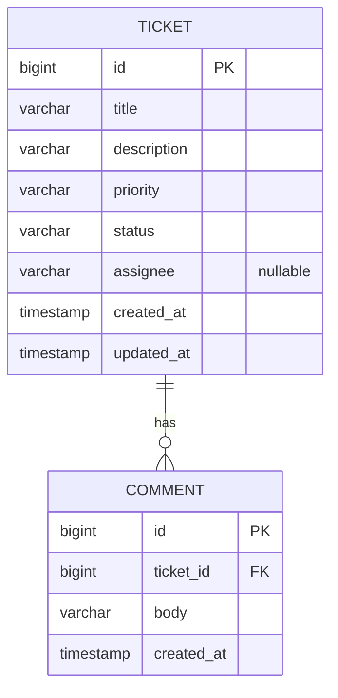

# Support Ticket Management System — Data Model

**Document status:** Draft for review  
**Version:** 0.1  
**Last updated:** 2026-10-26  
**Related:** [requirements.md](./requirements.md), [architecture.md](./architecture.md)

## 1. Purpose

Define the persistent domain model for **Ticket** and **Comment**: fields, types, constraints, relationships, enumerations, indexes to support list/filter/search, and how **assignee** is stored. This document is the source of truth for schema migrations and JPA entities.

---

## 2. Entity-relationship overview

Two tables. A ticket has zero or many comments; each comment belongs to exactly one ticket. There is no `User` table in v1.



**Cardinality:** `TICKET` 1 — 0..* `COMMENT`  
**Referential integrity:** `COMMENT.ticket_id` → `TICKET.id`, `ON DELETE RESTRICT` (tickets are not deleted in v1; restrict avoids orphan comments if delete is added later without a strategy).

---

## 3. Enumerations

Stored as **string values** in the database (`VARCHAR(32)`), mapped in JPA with `@Enumerated(EnumType.STRING)` so values are readable in SQL and portable between H2 and PostgreSQL.

### 3.1 `TicketStatus`

| Value | Meaning (documentation) | Notes |
|-------|-------------------------|--------|
| `OPEN` | New or not yet worked | Default on insert |
| `IN_PROGRESS` | Actively being handled | |
| `RESOLVED` | Work complete from support perspective | |
| `CLOSED` | Closed / no further action | Terminal |
| `CANCELLED` | Withdrawn or will not be completed | Terminal |

**Status changes:** Allowed only via the state machine in [state-machine.md](./state-machine.md), exposed through the dedicated status transition API—not via the general ticket update endpoint.

### 3.2 `TicketPriority`

| Value | Meaning |
|-------|---------|
| `LOW` | |
| `MEDIUM` | Default if API omits priority on create (per A-05) |
| `HIGH` | |

API layer should accept only these literals (case-sensitive in JSON; normalize on input if product prefers case-insensitive—define in OpenAPI).

---

## 4. Entity: `Ticket`

**Table name:** `ticket` (singular; avoid reserved word `tickets` issues on some tools—if the team prefers `tickets`, use that consistently in migrations and JPA `@Table`).

| Column (physical) | Property (Java) | SQL type | Nullable | Default | Constraints |
|-------------------|-----------------|----------|----------|---------|-------------|
| `id` | `id` | `BIGINT` | NO | generated | Primary key, identity / serial |
| `title` | `title` | `VARCHAR(200)` | NO | — | Not blank after trim |
| `description` | `description` | `VARCHAR(5000)` | NO | — | Not blank after trim |
| `priority` | `priority` | `VARCHAR(32)` | NO | `MEDIUM` | Must be valid `TicketPriority` |
| `status` | `status` | `VARCHAR(32)` | NO | `OPEN` | Must be valid `TicketStatus` |
| `assignee` | `assignee` | `VARCHAR(100)` | YES | `NULL` | Trim; empty string stored as `NULL` |
| `created_at` | `createdAt` | `TIMESTAMP` (UTC) | NO | set on insert | Immutable after insert |
| `updated_at` | `updatedAt` | `TIMESTAMP` (UTC) | NO | set on insert/update | Changes on any ticket update |

### 4.1 Identifier strategy

**Recommendation:** `BIGINT` surrogate key with database identity (`GENERATED BY DEFAULT AS IDENTITY` / `BIGSERIAL`).

| Option | Why / why not for this project |
|--------|--------------------------------|
| **BIGINT identity (chosen)** | Simple joins, compact indexes, natural fit for Spring Data `Long`; fine for single-database monolith. |
| UUID | Better for distributed ID generation; heavier indexes and URLs; unnecessary without multi-service writes. |

### 4.2 Timestamps

- All instants stored in **UTC** (`Instant` in Java, `TIMESTAMP WITH TIME ZONE` in PostgreSQL; H2 configured for UTC-aligned behaviour).
- `created_at`: set once when the row is inserted.
- `updated_at`: set on insert and on every successful update to title, description, priority, assignee, or **status** (via the status transition API; see [state-machine.md](./state-machine.md)). Idempotent same-state status requests do not bump `updated_at`.

Use JPA `@CreationTimestamp` / `@UpdateTimestamp` or explicit service-layer clocks—implementation detail; semantics above are normative.

### 4.3 Validation summary (application + DB)

| Field | Max length | Required on create | Updatable |
|-------|------------|--------------------|-----------|
| `title` | 200 | Yes | Yes |
| `description` | 5000 | Yes | Yes |
| `priority` | enum | Yes (default `MEDIUM`) | Yes |
| `status` | enum | Set by system (`OPEN`) | Via `/status` only; see [state-machine.md](./state-machine.md) |
| `assignee` | 100 | No | Yes (clear to `NULL`) |

---

## 5. Entity: `Comment`

**Table name:** `comment` (or `ticket_comment` if `comment` is reserved in a target DB—pick one name in the first migration).

| Column (physical) | Property (Java) | SQL type | Nullable | Default | Constraints |
|-------------------|-----------------|----------|----------|---------|-------------|
| `id` | `id` | `BIGINT` | NO | generated | Primary key |
| `ticket_id` | `ticketId` | `BIGINT` | NO | — | FK → `ticket.id` |
| `body` | `body` | `VARCHAR(2000)` | NO | — | Not blank after trim |
| `created_at` | `createdAt` | `TIMESTAMP` (UTC) | NO | set on insert | No `updated_at` in v1 |

Comments are **append-only** in v1 (no edit/delete). Ordering for display: `created_at ASC`, then `id ASC` as tiebreaker.

### 5.1 JPA relationship (logical)

- `Ticket` → `List<Comment>` one-to-many, mapped by `Comment.ticket` / `ticket_id`.
- Lazy-load comments on detail; list endpoint does not load comment bodies (avoid N+1 on list queries).

---

## 6. Assignee representation

### 6.1 Recommendation

Use a **nullable `VARCHAR(100)` column** on `ticket` (`assignee`) holding a **free-text display name or handle** (e.g. `"Ada Lovelace"`, `"team-billing"`).

This matches requirements assumption **A-08** and avoids a `user` table while user management is out of scope.

### 6.2 Tradeoff: text field vs foreign key to `User`

| Approach | Benefits | Drawbacks |
|----------|----------|-----------|
| **Text `assignee` (recommended for v1)** | No user service, auth, or sync; trivial create/update API; matches “type a name” UX; fast to build and test. | No referential integrity—typos and inconsistent spelling (`"ada"` vs `"Ada"`); renaming a person does not update historical tickets; cannot attach email/role/avatar; filter-by-assignee is string equality only unless normalized. |
| **FK to `User` table** | Canonical identity, consistent labels, future notifications and permissions; supports dropdown assignees. | Requires user CRUD or identity provider, seed data, migration path, and API surface not in scope; empty user base blocks realistic assignee UX unless you add sync from HR/SSO. |

**Conclusion:** For an assessment scope with **no authentication or user directory**, a **simple text field** is the proportionate choice. If you later add users, introduce a `user` table and optional `assignee_user_id` FK while keeping `assignee` as a denormalized display snapshot—or migrate text values to FKs in a one-off script.

### 6.3 Normalization rules

- Trim leading/trailing whitespace on write.
- Blank or whitespace-only assignee → store `NULL` (UI shows “Unassigned” or equivalent).
- No uniqueness constraint on assignee text.

---

## 7. Indexes

Designed for **status filtering** (equality), **default list ordering**, **comment lookup by ticket**, and **keyword search on title/description** (per A-11). Volume is expected to be small; indexes stay minimal and portable where possible.

| Index name | Table | Columns / definition | Supports |
|------------|-------|----------------------|----------|
| `pk_ticket` | `ticket` | `id` | PK (implicit) |
| `idx_ticket_status` | `ticket` | `(status)` | `?status=OPEN` filter (FR-20) |
| `idx_ticket_created_at` | `ticket` | `(created_at DESC)` | Recent-first list ordering |
| `idx_comment_ticket_id` | `comment` | `(ticket_id)` | Load comments for one ticket |
| `idx_comment_ticket_created` | `comment` | `(ticket_id, created_at)` | Ordered comment thread per ticket |

### 7.1 Keyword search (title + description)

Search is **case-insensitive substring** match on `title` and `description` only (not `comment.body`).

| Environment | Suggested approach |
|-------------|-------------------|
| **Small data (v1 default)** | `LOWER(title) LIKE LOWER(:q)` OR same for `description` with bound parameter; table scan acceptable for assessment scale. |
| **PostgreSQL (optional enhancement)** | `GIN` index on `to_tsvector('simple', coalesce(title,'') || ' ' || coalesce(description,''))` for full-text search, **or** `pg_trgm` indexes on `title` and `description` if substring search must stay fast at larger scale. |
| **H2 (dev)** | Same `LIKE` pattern; expression indexes are limited—rely on small datasets in dev/CI. |

**Spec minimum:** implement query semantics with `LIKE`/case-insensitive match; add **`idx_ticket_status`** and **`idx_ticket_created_at`** in all profiles. Document optional PostgreSQL FTS/trgm in `docs/` if added during implementation.

Do **not** index `assignee` unless filter-by-assignee becomes a requirement (API rules mention `assignedTo` for a future filter).

---

## 8. Example DDL (illustrative)

Dialect details may vary; Flyway/Liquibase migrations should encode the normative constraints above.

```sql
CREATE TABLE ticket (
    id              BIGINT GENERATED BY DEFAULT AS IDENTITY PRIMARY KEY,
    title           VARCHAR(200)  NOT NULL,
    description     VARCHAR(5000) NOT NULL,
    priority        VARCHAR(32)   NOT NULL,
    status          VARCHAR(32)   NOT NULL DEFAULT 'OPEN',
    assignee        VARCHAR(100),
    created_at      TIMESTAMP     NOT NULL,
    updated_at      TIMESTAMP     NOT NULL,
    CONSTRAINT chk_ticket_priority CHECK (priority IN ('LOW', 'MEDIUM', 'HIGH')),
    CONSTRAINT chk_ticket_status   CHECK (status IN ('OPEN', 'IN_PROGRESS', 'RESOLVED', 'CLOSED', 'CANCELLED'))
);

CREATE TABLE comment (
    id              BIGINT GENERATED BY DEFAULT AS IDENTITY PRIMARY KEY,
    ticket_id       BIGINT        NOT NULL,
    body            VARCHAR(2000) NOT NULL,
    created_at      TIMESTAMP     NOT NULL,
    CONSTRAINT fk_comment_ticket FOREIGN KEY (ticket_id) REFERENCES ticket (id) ON DELETE RESTRICT
);

CREATE INDEX idx_ticket_status ON ticket (status);
CREATE INDEX idx_ticket_created_at ON ticket (created_at DESC);
CREATE INDEX idx_comment_ticket_id ON comment (ticket_id);
CREATE INDEX idx_comment_ticket_created ON comment (ticket_id, created_at);
```

PostgreSQL may use `TIMESTAMPTZ` and `BIGSERIAL`; H2 migration scripts should use equivalent types.

---

## 9. Mapping to requirements

| Requirement / assumption | Data model element |
|--------------------------|-------------------|
| FR-02, NFR-01 | Relational tables, durable H2 file / PostgreSQL |
| FR-08 | Updatable: `title`, `description`, `priority`, `assignee` |
| FR-20 | `status` column + `idx_ticket_status` |
| FR-17–18, A-11 | Query on `title`, `description` |
| FR-12–14, A-14 | `comment` table, FK, `created_at` ordering |
| A-06, A-07 | `TicketPriority`, `TicketStatus` enums |
| A-09 | Ticket `created_at` / `updated_at`; comment `created_at` only |
| A-16 | VARCHAR limits as specified |

---

## 10. Out of scope (data layer)

- `user`, `role`, session, or audit tables  
- Soft delete (`deleted_at`) on ticket or comment  
- Ticket status history or comment edit history tables  
- Attachments, tags, many-to-many assignees  

Changes to these should start with an update to [requirements.md](./requirements.md) and this file before schema changes.
