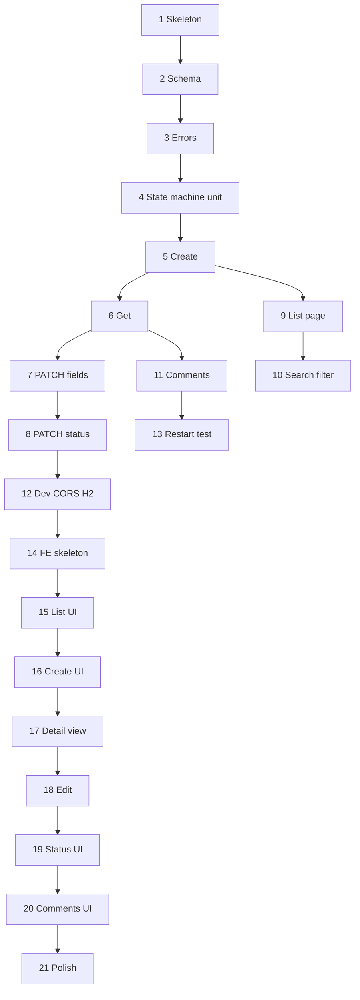

# Support Ticket Management System — Implementation Plan

**Document status:** Approved (execution complete; see §7)  
**Version:** 0.2  
**Last updated:** 2026-10-26  
**Related:** All documents in `spec/`; [.cursor/rules/java-springboot.md](../.cursor/rules/java-springboot.md), [testing.md](../.cursor/rules/testing.md)

## 1. How to use this plan

- Execute tasks **in order**. Each task is a small **vertical slice** with a **Definition of Done (DoD)** and **tests** you can run before moving on.
- **Do not skip verification** — every task should leave the repo in a runnable or test-green state.
- Map work to IDs in [test-strategy.md](./test-strategy.md) and acceptance criteria in [requirements.md](./requirements.md).
- **No implementation** is implied by this document alone; start coding only when you begin Task 1.

## 2. Prerequisites (before Task 1)

- JDK 21, Node.js 20+ for frontend (see root [README.md](../README.md)).
- Repo layout: `backend/`, `frontend/` per [architecture.md](./architecture.md).

---

## 3. Task list

### Task 1 — Backend skeleton and smoke run

**Goal:** Empty Spring Boot app starts; test toolchain works.

**Work:**

- Initialize `backend/` (Maven or Gradle): Java 21, Spring Boot 3.x, Web, Validation, Data JPA, H2, Flyway (or chosen migration tool per plan).
- `application.yml` + `application-dev.yml` placeholder; `spring.application.name`.
- Optional: `GET /actuator/health` or minimal `GET /api/v1/health` returning 200.

**DoD:**

- `cd backend && ./mvnw spring-boot:run` (or Gradle equivalent) starts without error.
- One smoke test passes (context loads or health endpoint 200).

**Tests:**

- `BackendContextSmokeTest` — `@SpringBootTest` context loads.

**Verify:** App starts; smoke test green.

---

### Task 2 — Database schema and JPA entities

**Goal:** `ticket` and `comment` tables exist; entities map to [data-model.md](./data-model.md).

**Work:**

- Flyway migration `V1__...sql` with tables, checks, indexes from data-model §8.
- JPA entities `Ticket`, `Comment`, enums `TicketStatus`, `TicketPriority`.
- `application-test.yml` with H2 for tests.

**DoD:**

- Migration runs on startup (dev + test).
- Entities persist via a trivial `@DataJpaTest` save/find.

**Tests:**

- REPO-01, REPO-02 (`@DataJpaTest`).

**Verify:** `./mvnw test` — repository tests pass.

---

### Task 3 — Standard API error envelope

**Goal:** All errors match [api-contract.md](./api-contract.md) §1.2 and api-standards.

**Work:**

- `ApiErrorResponse` record + field error type.
- `@RestControllerAdvice` for validation (`MethodArgumentNotValidException`), not found, generic 500.
- Stub controller throwing sample validation (or test-only controller) if needed.

**DoD:**

- MockMvc POST with invalid body returns 400 JSON with `error`, `message`, `errors[]`.

**Tests:**

- `GlobalExceptionHandlerTest` (MockMvc or `@WebMvcTest`).

**Verify:** Error shape test green; manual curl optional.

---

### Task 4 — Ticket status transition policy (unit)

**Goal:** State machine logic isolated per [state-machine.md](./state-machine.md).

**Work:**

- `TicketStatusTransitionPolicy` (or equivalent): `validateTransition(from, to)` / `isAllowed`.
- Domain exception `InvalidStateTransitionException` for disallowed pairs.

**DoD:**

- All five allowed distinct transitions return allowed; representative forbidden pairs throw or return false per design.

**Tests:**

- SM-U-01, SM-U-02, SM-U-03 (JUnit, no Spring).

**Verify:** `./mvnw test` — policy tests only, fast.

---

### Task 5 — Create ticket (service + API)

**Goal:** `POST /api/v1/tickets` end-to-end.

**Work:**

- DTOs: `CreateTicketRequest`, `TicketResponse`.
- `TicketService.create`, `TicketController` POST, mapper entity↔DTO.
- Reject unknown properties (`@JsonIgnoreProperties` or Jackson fail on unknown).
- Reject `status` in create body with 400.

**DoD:**

- `201` + `Location` + body `status=OPEN`, default `MEDIUM` priority.
- AC-01 API portion satisfied.

**Tests:**

- API-01; VAL-C-01–12 (subset in `TicketCreateIntegrationTest`).
- AC-03 API portion.

**Verify:** Run app; `POST` ticket via curl/Postman; `GET` by id works.

---

### Task 6 — Get ticket by ID

**Goal:** `GET /api/v1/tickets/{ticketId}`.

**Work:**

- Service `getById`; 404 `NOT_FOUND` when missing.
- Malformed id handling per api-contract (document choice in test).

**DoD:**

- `200` with full `TicketResponse`; `404` with standard body.

**Tests:**

- API-03; AC-06 API portion; VAL path id cases as chosen.

**Verify:** GET existing and missing id.

---

### Task 7 — Update ticket fields (PATCH)

**Goal:** `PATCH /api/v1/tickets/{id}` for title, description, priority, assignee only.

**Work:**

- `UpdateTicketRequest` (optional fields); at least one field required.
- Reject `status` in body → 400 with field error (API-G-01).
- Trim assignee; blank → null.

**DoD:**

- AC-07, AC-08, AC-09 API portions.

**Tests:**

- API-04; VAL-U-01–09; API-G-01.

**Verify:** PATCH fields; confirm status unchanged.

---

### Task 8 — Change ticket status (PATCH /status)

**Goal:** `PATCH /api/v1/tickets/{id}/status` with full state machine enforcement.

**Work:**

- `UpdateTicketStatusRequest`; service calls policy; map 409 to `INVALID_STATE_TRANSITION`.
- Idempotent same-state: 200, no `updatedAt` bump (state-machine §7.5).

**DoD:**

- All SM-01–SM-25 behaviours (parameterized integration test).
- AC-20, AC-22 API portions.

**Tests:**

- `TicketStatusTransitionIntegrationTest` — full matrix §6.2 [test-strategy.md](./test-strategy.md).
- API-05; example 409 body.

**Verify:** Run parameterized suite; spot-check OPEN → IN_PROGRESS → … → CLOSED via curl.

---

### Task 9 — List tickets with pagination

**Goal:** `GET /api/v1/tickets` with page envelope.

**Work:**

- Spring Data `Pageable`; response envelope per api-contract.
- Default `sort=createdAt,desc`, `size=20`.

**DoD:**

- Paginated list returns `content`, `totalElements`, etc.
- AC-04 API portion (multiple pages).

**Tests:**

- API-02; SF-12; VAL-Q-01–02.

**Verify:** Seed data; request page 0 and 1.

---

### Task 10 — Search and filters on list

**Goal:** `query`, `status`, `priority`, `assignee` on GET list per contract.

**Work:**

- Custom repository query or specification: case-insensitive title/description; AND filters.
- Invalid `status`/`priority`/`sort` → 400 (FR-22).

**DoD:**

- AC-13–17 API portions; A-11–A-13.

**Tests:**

- SF-01–SF-11; VAL-Q-03–05; REPO-04–08 if custom query.

**Verify:** Integration tests green; manual search + status filter.

---

### Task 11 — Comments API

**Goal:** `POST` and `GET` `/api/v1/tickets/{id}/comments`.

**Work:**

- `CreateCommentRequest`, `CommentResponse`; paginated GET default `createdAt,asc`.
- 404 if ticket missing.

**DoD:**

- AC-10–12 API portions; comments do not change ticket status.

**Tests:**

- API-06, API-07; VAL-M-01–05.

**Verify:** Add comment; list comments; restart optional until Task 13.

---

### Task 12 — Dev profile: file H2, CORS

**Goal:** Local dev matches [architecture.md](./architecture.md) §5–6.

**Work:**

- `application-dev.yml`: `jdbc:h2:file:./data/tickets` (or documented path).
- `CorsConfig` active on `dev` profile; `CORS_ALLOWED_ORIGINS`.
- `.env.example` for backend/frontend.

**DoD:**

- App starts on `dev`; data file created under `./data/`.
- Browser from Vite origin can call API (manual or WebMvc cors test).

**Tests:**

- Optional `CorsIntegrationTest` on dev profile; document manual check in `docs/`.

**Verify:** Run dev profile; create ticket; see file DB grow.

---

### Task 13 — Persistence across restart (backend)

**Goal:** AC-02 / PERSIST-01.

**Work:**

- Automated test with two context cycles or documented script using file H2 URL.
- See [test-strategy.md](./test-strategy.md) §9.

**DoD:**

- PERSIST-01 passes in CI or as documented local gate.

**Tests:**

- `PersistenceAcrossRestartIntegrationTest` (or manual checklist in README).

**Verify:** Test or manual README steps pass.

---

### Task 14 — Frontend skeleton and API client

**Goal:** Vite + React + TypeScript app runs; typed client for API.

**Work:**

- Initialize `frontend/`; React Router; `VITE_API_BASE_URL`.
- `src/api/client.ts` + types mirroring `TicketResponse`, errors, pagination.
- Map API `errors[]` to a small helper for forms.

**DoD:**

- `npm run dev` serves app; client can call health or list (even if UI blank).

**Tests:**

- Optional: unit test for error-mapping helper.

**Verify:** Dev server + network call to backend list (empty array OK).

---

### Task 15 — Ticket list page

**Goal:** [ui-flow.md](./ui-flow.md) §5 — search, single status filter, pagination, states.

**Work:**

- Route `/tickets`; table; URL query sync for `query`, `status`, `page`.
- Loading, empty, error banner, retry.

**DoD:**

- AC-04, AC-13–16 UI portions; FR-04–05, FR-17–20.

**Tests:**

- FE-06, FE-07; manual walkthrough.

**Verify:** List tickets from backend; search and filter; paginate.

---

### Task 16 — Create ticket page

**Goal:** [ui-flow.md](./ui-flow.md) §6.

**Work:**

- Route `/tickets/new`; form; validation display §3.1; redirect to detail on 201.

**DoD:**

- AC-01, AC-03 UI portions.

**Tests:**

- FE-01, FE-02.

**Verify:** Create ticket end-to-end from UI.

---

### Task 17 — Ticket detail (read-only)

**Goal:** Detail view without edit: fields, status badge, back link.

**Work:**

- Route `/tickets/:ticketId`; GET ticket; 404 state.

**DoD:**

- AC-05, AC-06 UI portions.

**Tests:**

- Manual; optional RTL smoke.

**Verify:** Open ticket from list; 404 for bad id.

---

### Task 18 — Ticket detail edit mode

**Goal:** PATCH fields; cancel/save; validation errors on form.

**Work:**

- Edit toggle; PATCH on save; AC-07, AC-08.

**DoD:**

- Field errors inline; summary banner; no `status` in PATCH body.

**Tests:**

- FE-01 patterns on edit form; manual AC-07–08.

**Verify:** Edit title; see validation on bad input.

---

### Task 19 — Status actions on detail

**Goal:** [ui-flow.md](./ui-flow.md) §4, §7.6 — valid buttons only; 409 handling.

**Work:**

- Status section; confirm for cancel; PATCH `/status`; re-fetch on 409.

**DoD:**

- AC-20–22 UI portions; FR-25–27.

**Tests:**

- FE-03, FE-04, FE-05.

**Verify:** Full happy path OPEN → CLOSED from UI; trigger 409 only if forcing stale state (optional).

---

### Task 20 — Comments section on detail

**Goal:** List + add comments; loading/empty/errors.

**Work:**

- GET comments (paginated or first page); POST comment; inline body errors.

**DoD:**

- AC-10–11 UI portions; FR-12–14.

**Tests:**

- FE-08; manual AC-10.

**Verify:** Add comment; see thread; empty state.

---

### Task 21 — Polish, README, and full regression

**Goal:** Assessment-ready repo.

**Work:**

- Root/`docs/` README: run backend (dev), frontend, tests, env vars.
- Ensure `.specstory/history` guidance unchanged.
- `prod` profile stub for PostgreSQL (config only if not wired yet).

**DoD:**

- `./mvnw test` and `npm test` green.
- All AC-01–22 verifiable manually from README test plan.
- Spec traceability: no known contradictions in `spec/`.

**Tests:**

- Full backend suite; FE-01–08; PERSIST-01.

**Verify:** Clean clone → follow README → demo full flow.

---

## 4. Task dependency overview

Tasks 9–11 can proceed in parallel after Task 8 if multiple developers; order above is safest for solo work.

---

## 5. Traceability matrix (tasks → acceptance)

| AC | Tasks |
|----|--------|
| AC-01–03 | 5, 16 |
| AC-02 | 12, 13 |
| AC-04–06 | 9, 15, 17 |
| AC-07–09 | 7, 18 |
| AC-10–12 | 11, 20 |
| AC-13–17 | 10, 15 |
| AC-18–19 | 3, 15–20 |
| AC-20–22 | 8, 19 |

---

## 6. Out of plan scope (explicit)

- PostgreSQL deployment automation (config stub only in Task 21).
- OpenAPI file generation (optional follow-up).
- E2E Playwright/Cypress.
- Authentication.

---

## 7. Implementation status (2026-10-26)

| Area | Status | Notes |
|------|--------|--------|
| Backend API & persistence | **Done** | Tasks 1–11; 80 `mvn test` tests green |
| PERSIST-01 | **Done** | `PersistenceAcrossRestartIntegrationTest` + README manual steps |
| Frontend UI | **Done** | List, create, detail, edit, status actions, comments (Tasks 14–20) |
| Task 12 CORS | **Partial** | Vite proxy used instead; optional `CorsConfig` deferred |
| Task 21 polish | **Done** | README, `docs/api.md`, spec sync |
| FE-01–08 Vitest | **Partial** | `useComments` regression test; expand per test-strategy §10 |

Post-review fixes (regression-tested): PATCH blank-field validation, unknown JSON properties on PATCH, 500 logging, list `priority`/`assignee` filters, comment load-more errors.
