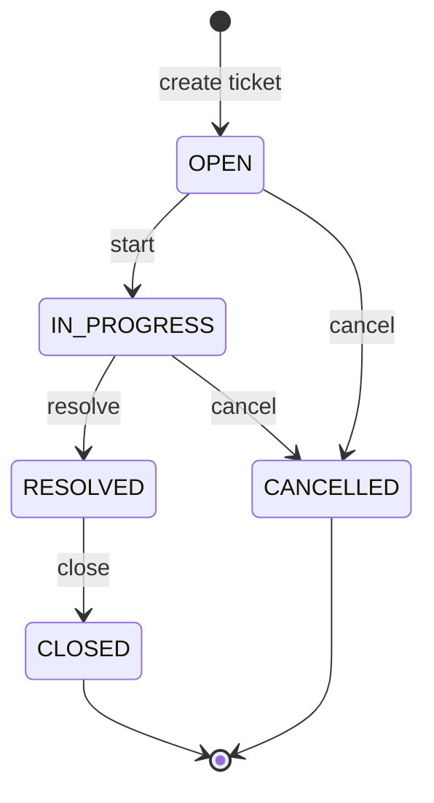

# Support Ticket Management System — Ticket Status State Machine

**Document status:** Draft for review  
**Version:** 0.1  
**Last updated:** 2026-10-26  
**Related:** [requirements.md](./requirements.md), [data-model.md](./data-model.md), [architecture.md](./architecture.md)

## 1. Purpose

The backend **must enforce** legal ticket status changes. Illegal transitions are rejected with a consistent HTTP response. This document is normative for service-layer rules, API design, and tests.

**Supersedes** the earlier data-model note that status was not user-updatable in v1; status changes are allowed only through the rules below.

---

## 2. States

| State | Code | Description | Terminal? |
|-------|------|-------------|-----------|
| Open | `OPEN` | Ticket created; work not started or reopened is **not** supported in v1 | No |
| In progress | `IN_PROGRESS` | Actively being worked | No |
| Resolved | `RESOLVED` | Fix or answer provided; awaiting closure | No |
| Closed | `CLOSED` | Completed lifecycle | **Yes** — no outbound transitions |
| Cancelled | `CANCELLED` | Will not be completed (withdrawn, duplicate, etc.) | **Yes** — no outbound transitions |

**Initial state:** On ticket creation, `status` is always `OPEN`. Clients cannot set a different status on create.

**Terminal states:** `CLOSED` and `CANCELLED`. Any request to leave these states is **invalid** (including `CLOSED` → `OPEN`, `RESOLVED` → `OPEN`, `CANCELLED` → `OPEN`, etc.).

---

## 3. Allowed transitions

Only the following **direct** transitions are permitted. There are no skip-ahead shortcuts (e.g. `OPEN` → `RESOLVED` is **not** allowed).

| From | To | Notes |
|------|-----|--------|
| `OPEN` | `IN_PROGRESS` | Start work |
| `OPEN` | `CANCELLED` | Cancel before or without progressing |
| `IN_PROGRESS` | `RESOLVED` | Work finished |
| `IN_PROGRESS` | `CANCELLED` | Abandon while in progress |
| `RESOLVED` | `CLOSED` | Confirm closure after resolution |

**Count:** 5 allowed transitions. All other ordered pairs `(from, to)` where `from ≠ to` are **forbidden**.

### 3.1 Examples of forbidden transitions (non-exhaustive)

| From | To | Reason |
|------|-----|--------|
| `CLOSED` | `OPEN` | Terminal state; no reopen in v1 |
| `RESOLVED` | `OPEN` | No backward transition |
| `CANCELLED` | `OPEN` | Terminal state |
| `OPEN` | `RESOLVED` | Must pass through `IN_PROGRESS` |
| `OPEN` | `CLOSED` | Must pass through `IN_PROGRESS` and `RESOLVED` |
| `RESOLVED` | `IN_PROGRESS` | No backward transition |
| `RESOLVED` | `CANCELLED` | Not in allowed set |
| `CLOSED` | `CANCELLED` | Terminal state |
| `IN_PROGRESS` | `OPEN` | Not in allowed set |
| `CANCELLED` | `IN_PROGRESS` | Terminal state |

---

## 4. Transition table (machine-readable)

| Current state ↓ / Target → | `IN_PROGRESS` | `RESOLVED` | `CLOSED` | `CANCELLED` |
|----------------------------|---------------|------------|----------|-------------|
| **`OPEN`** | ✓ | ✗ | ✗ | ✓ |
| **`IN_PROGRESS`** | ✗ | ✓ | ✗ | ✓ |
| **`RESOLVED`** | ✗ | ✗ | ✓ | ✗ |
| **`CLOSED`** | ✗ | ✗ | ✗ | ✗ |
| **`CANCELLED`** | ✗ | ✗ | ✗ | ✗ |

(✓ = allowed, ✗ = rejected by backend)

**Note:** This table shows targets `IN_PROGRESS` through `CANCELLED`. Transitions **to `OPEN`** are never allowed (except idempotent `OPEN` → `OPEN` via same-state handling in §7.5). The complete **5×5** matrix including `OPEN` as a target column is in [test-strategy.md](./test-strategy.md) §6.1.

---

## 5. State diagram



---

## 6. Enforcement layer

| Layer | Responsibility |
|-------|----------------|
| **Domain / service** | Single component (e.g. `TicketStatusTransitionPolicy` or method on `TicketService`) evaluates `(currentStatus, targetStatus)` using the table in §4. All status changes go through this check inside a transaction. |
| **API** | Exposes status change only via the dedicated transition operation (§8). Generic ticket update must not apply `status`. |
| **Persistence** | `status` column stores current state; DB `CHECK` constraint lists valid enum values only—not valid *transitions* (transitions stay in application code). |

---

## 7. HTTP behaviour for status changes

### 7.1 Successful transition

- **HTTP `200 OK`**
- Response body: full ticket representation (including new `status`, updated `updatedAt`).
- No `201` unless the API models transitions as sub-resource creation (not recommended here).

### 7.2 Ticket not found

- **HTTP `404 Not Found`**
- `error`: `NOT_FOUND`
- Evaluated before transition rules.

### 7.3 Invalid transition (forbidden edge)

When `currentStatus` and requested `targetStatus` differ and the pair is not in §3:

- **HTTP `409 Conflict`**
- `error`: **`INVALID_STATE_TRANSITION`** (machine-readable code for UI and tests)
- `message`: Human-readable, e.g. `"Cannot transition ticket from CLOSED to OPEN."`
- `errors`: Empty array or omitted (not a field-validation problem).

Example body:

```json
{
  "timestamp": "2026-10-26T09:15:00.000Z",
  "status": 409,
  "error": "INVALID_STATE_TRANSITION",
  "message": "Cannot transition ticket from CLOSED to OPEN.",
  "errors": []
}
```

Optional extension (implementation): include structured fields in a `details` object, e.g. `currentStatus`, `targetStatus`—only if documented in OpenAPI; not required for v1.

**Why 409, not 422:** Project API standards group illegal state transitions under **409 Conflict** (business/state conflict with current resource). **422** remains for semantic validation of payloads; **400** for malformed JSON or Bean Validation on field shapes.

### 7.4 Unknown or missing target status

- Invalid enum value in request body: **HTTP `400 Bad Request`**, `error`: `BAD_REQUEST`, field error on `status` (or `targetStatus`).

### 7.5 Transition to the **same** state (no-op)

When requested `targetStatus` equals the ticket’s current `status`:

| Approach | HTTP | When to use |
|----------|------|-------------|
| **Recommended: idempotent success** | **`200 OK`** | Return the ticket unchanged. No database write required (optional: skip `updatedAt` bump). Treat as “already in desired state.” |
| Strict transition semantics | `409 Conflict`, `error`: `INVALID_STATE_TRANSITION` or `SAME_STATE` | Only if product insists every call must denote a *change* |

**Recommendation:** **`200 OK` idempotent.** Clients may safely retry; load balancers and optimistic UI benefit. Log at debug level if useful.

---

## 8. Dedicated transition endpoint vs general update

### 8.1 Recommendation (normative for this project)

| Operation | Endpoint (illustrative) | May change `status`? |
|-----------|-------------------------|----------------------|
| **General update** | `PATCH /api/v1/tickets/{id}` | **No** |
| **Status transition** | `PATCH /api/v1/tickets/{id}/status` | **Yes** (only here) |

**General update body** includes only: `title`, `description`, `priority`, `assignee` (per original requirements).  

**Status transition body** is minimal, e.g.:

```json
{
  "status": "IN_PROGRESS"
}
```

Alternative shape `{ "targetStatus": "IN_PROGRESS" }` is acceptable if used consistently in OpenAPI; field name is fixed in the API spec.

### 8.2 If `status` appears on the general update request

**Do not** silently ignore—clients could believe they changed status when they did not.

| Behaviour | HTTP | `error` |
|-----------|------|---------|
| **Recommended** | **`400 Bad Request`** | `BAD_REQUEST` |
| Message | e.g. `"Status cannot be updated via this endpoint. Use PATCH /api/v1/tickets/{id}/status."` | |
| Field error | `field`: `status`, `message`: same guidance | |

Optional stricter variant: reject the **entire** PATCH if `status` is present (even null), so partial updates stay unambiguous.

### 8.3 Rationale

1. **Single enforcement point** — The state machine runs in one code path invoked only by the status endpoint. No risk of a generic mapper applying `status` without calling the transition policy.
2. **Clear API contract** — Callers know that changing workflow state is an explicit action, distinct from editing content or assignment.
3. **Easier testing** — Table-driven tests for all allowed/forbidden pairs on one endpoint; update tests do not need duplicate transition matrices.
4. **Future extensions** — Transition reason, comment-on-close, or audit events attach naturally to `/status` without complicating generic PATCH.
5. **Aligns with project rules** — API standards already suggest `PATCH .../status` for state transitions.

**Tradeoff:** Two calls if the user edits title and moves status in one form. The UI can issue PATCH for fields and PATCH `/status` sequentially, or the UI guides workflow steps—acceptable for a small app.

### 8.4 Anti-pattern (do not implement)

- Accepting `status` on `PATCH /tickets/{id}` and running the same validator—works if disciplined, but duplicate entry points and OpenAPI docs often drift; one client will send status only on general update and bypass tests.

---

## 9. Interaction with other rules

| Topic | Rule |
|-------|------|
| **Comments** | Adding a comment does **not** change `status`. |
| **Create** | `status` is always `OPEN`; if `status` appears on create body → **400** with field error (do not silently ignore). |
| **Filter by status** | `CANCELLED` is a valid filter value alongside other states (FR-20). |
| **`updatedAt`** | Successful status transition updates `updatedAt` (same as other ticket updates). Idempotent same-state `200` should **not** bump `updatedAt` unless you explicitly want retry to look like activity (default: no bump). |

---

## 10. Test matrix (acceptance)

Implement automated tests covering at least:

1. Each ✓ cell in §4 → `200` and persisted new status.
2. Representative ✗ cells (including `CLOSED`→`OPEN`, `RESOLVED`→`OPEN`, `CANCELLED`→`OPEN`) → `409`, `INVALID_STATE_TRANSITION`.
3. Same-state request on `/status` → `200`, status unchanged.
4. `PATCH /tickets/{id}` with `status` in body → `400`, ticket status unchanged.
5. `PATCH /tickets/{id}` without `status` → still updates other fields regardless of current status (including terminal states), unless a separate rule forbids editing closed tickets ( **not** in scope—editing title on `CLOSED` is allowed unless product says otherwise).

---

## 11. Traceability

| Item | ID / doc |
|------|----------|
| Status filter | FR-20 |
| Error shape | `.cursor/rules/api-standards.md` |
| `CANCELLED` enum value | [data-model.md](./data-model.md) (updated) |

When OpenAPI is added, `/tickets/{id}/status` and error `INVALID_STATE_TRANSITION` must match this document.
